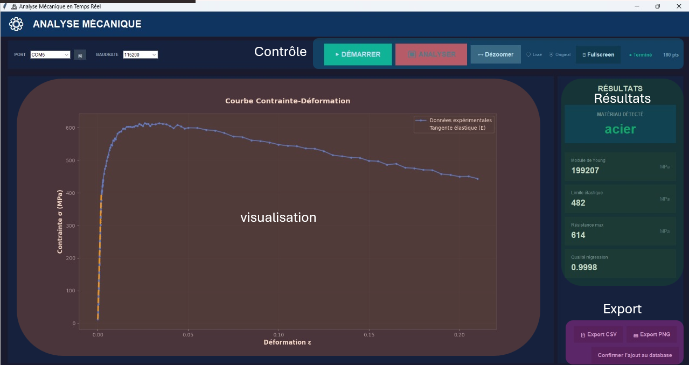
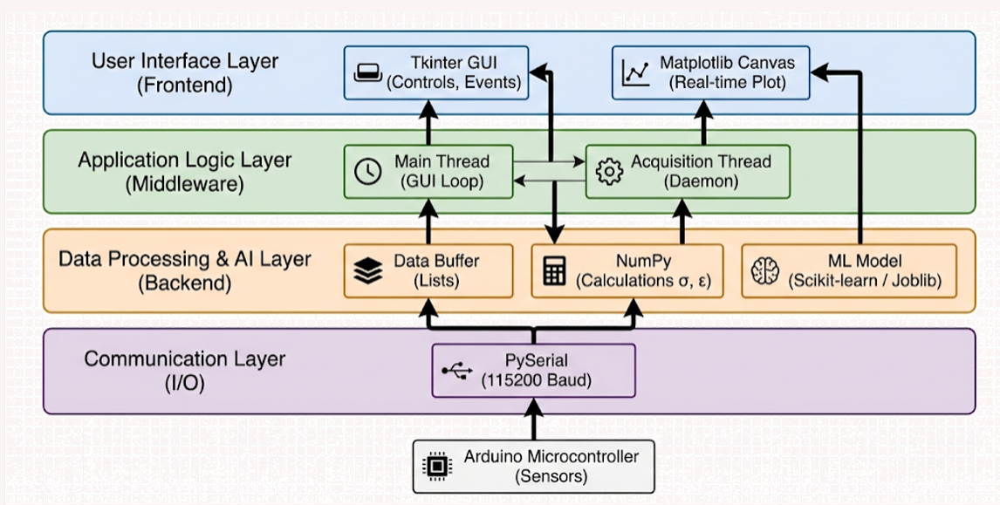
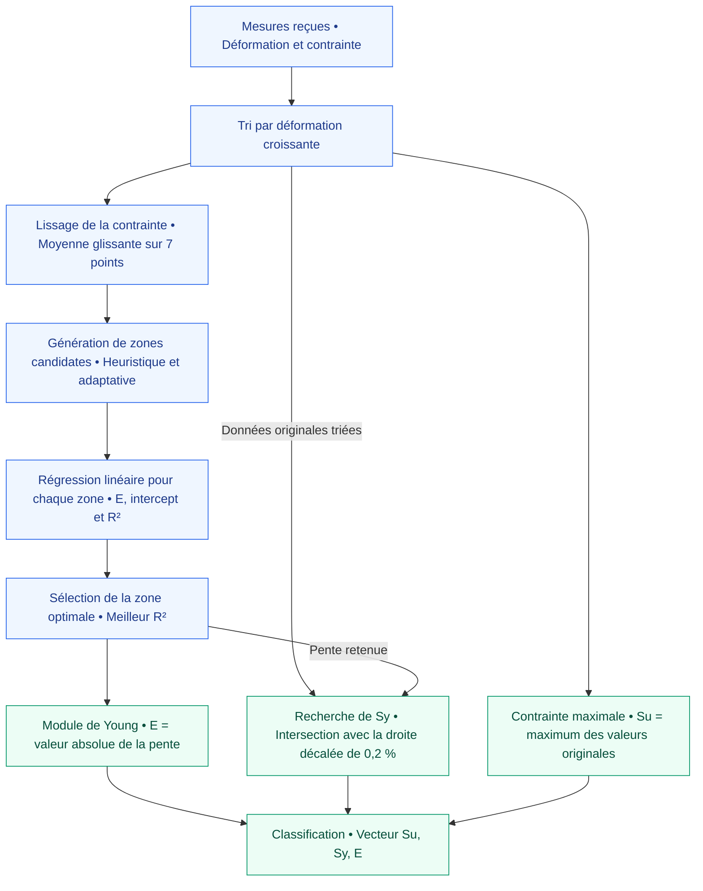
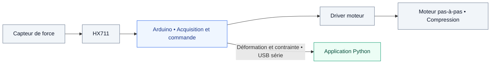
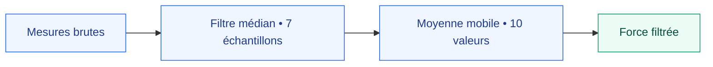

# Machine d’essai uniaxiale intelligente

**Acquisition en temps réel · Analyse mécanique · Identification des matériaux**


Une interface de laboratoire pour suivre des essais de compression uniaxiale, extraire les propriétés mécaniques d’un échantillon et proposer une identification parmi **11 familles de matériaux**.

Développé dans le cadre d’un projet de robotique, le système associe une machine de compression pilotée par Arduino à une application Python. Ce dépôt contient l’application de bureau et les fichiers de modèle utilisés pour la classification.



## Sommaire

- [Fonctionnalités](#fonctionnalités)
- [Architecture](#architecture)
- [Analyse mécanique](#analyse-mécanique)
- [Identification des matériaux](#identification-des-matériaux)
- [Installation](#installation)
- [Utilisation](#utilisation)
- [Communication et matériel](#communication-et-matériel)
- [Contenu du dépôt](#contenu-du-dépôt)

## Fonctionnalités

| Fonction | Description |
| :--- | :--- |
| Acquisition série | Détection des ports COM et réception des couples déformation–contrainte via PySerial. |
| Visualisation | Courbe actualisée toutes les 100 ms, affichage original ou lissé, zoom par sélection et plein écran. |
| Analyse mécanique | Calcul du module de Young, de la limite élastique, de la contrainte maximale et du coefficient R². |
| Classification | Prédiction d’une famille de matériaux à partir des propriétés mécaniques extraites. |
| Fin d’essai | Analyse à la demande ou déclenchée par le message de fin transmis par Arduino. |
| Export et historique | Export CSV, capture PNG et ajout des résultats à un historique CSV local. |

## Architecture

L’application suit quatre responsabilités : communication, acquisition, traitement et présentation. Elles sont regroupées dans un même fichier, [`main_gui.py`](main_gui.py).



| Classe | Responsabilité |
| :--- | :--- |
| `ModernTheme` | Palette de couleurs et constantes visuelles. |
| `MaterialAnalyzer` | Lissage, sélection de la zone élastique et calcul des propriétés mécaniques. |
| `MLPredictor` | Chargement du modèle, prédiction et décodage des classes. |
| `ModernAnalysisApp` | Interface, acquisition série, affichage et exports. |

## Analyse mécanique

L’application reçoit des valeurs de **déformation sans unité** et de **contrainte en MPa**, déjà calculées en amont. L’analyse nécessite au moins **10 points**.



### Détermination de la zone élastique

Le schéma reprend la méthode décrite dans le projet : générer des zones candidates par une approche heuristique et adaptative, effectuer une régression linéaire sur chaque zone, puis retenir celle présentant le meilleur R².

Identification automatique de la région linéaire selon les seuils décrits initialement :

| Condition | Zone élastique |
| :--- | :--- |
| Déformation maximale ≥ 0,5 % | Points où ε ≤ 0,2 %. |
| Sinon | Premiers 20 % de la courbe. |

Dans `main_gui.py`, ces seuils sont appliqués à la déformation recentrée ; la comparaison de plusieurs zones candidates n’y est pas encore implémentée.

### Propriétés calculées

| Propriété | Calcul dans l’application | Unité |
| :--- | :--- | :--- |
| **E — Module de Young** | Valeur absolue de la pente de régression sur la contrainte lissée. | MPa |
| **Sy — Limite élastique** | Recherche d’une intersection avec la droite décalée de 0,2 %, puis interpolation. | MPa |
| **Su — Contrainte maximale** | Maximum de la contrainte originale. | MPa |
| **R² — Qualité de régression** | Coefficient de détermination sur la zone élastique retenue. | Sans unité |

**Comportement actuel :** si aucune intersection n’est détectée pour Sy, le programme utilise `0.8 × Su`. Cette valeur de repli est une estimation. Le calcul de Sy utilise la déformation originale et la pente signée, tandis que la régression utilise une déformation recentrée ; ces conventions doivent être prises en compte lors de l’interprétation des résultats.

## Identification des matériaux

Deux algorithmes de classification sont présentés dans le projet : **Random Forest** et **K-Nearest Neighbors (KNN)**. Ils identifient les matériaux à partir des propriétés mécaniques extraites. Le Random Forest est le modèle utilisé dans l’interface actuelle.

L’application charge [`rf_material_classifier.pkl`](rf_material_classifier.pkl) et transmet les propriétés dans l’ordre **`[Su, Sy, E]`**, en MPa. Le fichier `label_encoder.pkl` permet de décoder les classes lorsqu’il est disponible.

| Famille | Classes |
| :--- | :--- |
| Métaux ferreux | Acier, fonte grise, fonte malléable, fonte nodulaire. |
| Alliages non ferreux | Alliage d’aluminium, alliage de cuivre, alliages de magnésium, laiton. |
| Bronzes | Bronze au manganèse, bronze d’aluminium, bronze à l’étain. |

### Modèles et résultats documentés

La documentation initiale rapporte un Random Forest de **100 arbres** et une exactitude de **78,72 %** sur le jeu de test. Le fichier [`knn_model_metadata.json`](knn_model_metadata.json) décrit un autre modèle : un KNN à **5 voisins**, avec une exactitude de **93,43 %**. Ces résultats correspondent à deux modèles distincts ; l’application actuelle utilise uniquement le Random Forest.

La répartition d’entraînement décrite dans la documentation initiale et les métadonnées KNN est la suivante :

| Jeu de données | Nombre d’échantillons |
| :--- | ---: |
| Entraînement — données originales | 1 152 |
| Entraînement — données augmentées | 8 954 |
| **Total entraînement** | **10 106** |
| Test — données originales uniquement | 289 |

Les données et scripts d’entraînement ne sont pas inclus dans ce dépôt ; ces scores ne peuvent donc pas y être reproduits directement. Le normaliseur `scaler.pkl` est présent, mais n’est pas utilisé par l’application actuelle.

## Installation

### 1. Récupérer le projet

```bash
git clone https://github.com/mohamedamineyoukaoui-ops/Robotique__Machine-d-Essai-Uniaxiale-Intelligente.git
cd Robotique__Machine-d-Essai-Uniaxiale-Intelligente
```

### 2. Installer les dépendances

Une installation Python avec Tkinter est nécessaire. La version de scikit-learn doit être compatible avec celle ayant servi à enregistrer le modèle ; cette version n’est pas précisée dans le dépôt.

```bash
python -m pip install numpy matplotlib pyserial joblib scikit-learn
```

### 3. Configurer les chemins locaux

Avant le premier lancement, adapter les chemins absolus présents dans `main_gui.py` à l’emplacement des fichiers sur votre ordinateur.

| Emplacement dans le code | Configuration |
| :--- | :--- |
| `MLPredictor.__init__` → `model_path` | Chemin de `rf_material_classifier.pkl`. Placer `label_encoder.pkl` dans le même dossier. |
| `export_png`, `export_csv`, `get_database_path` → `base` | Dossier de destination des exports et de l’historique. |

Le chemin du modèle pointe actuellement vers `C:\Users\simoo\OneDrive\Bureau\interface_robotique\rf_material_classifier.pkl`, et les exports vers `C:\Users\simoo\OneDrive\Bureau\exports`.

### 4. Démarrer l’application

```bash
python main_gui.py
```

## Utilisation

1. **Connecter** l’Arduino par USB, sélectionner son port COM et régler le débit série, par défaut à **115200 bauds**.
2. **Acquérir** les mesures avec **DÉMARRER**. La courbe apparaît au fil des données reçues.
3. **Analyser** avec **ANALYSER**, ou laisser le message `# FIN DU TEST` déclencher l’analyse automatiquement.
4. **Examiner** les propriétés mécaniques, la famille prédite et la courbe. Utiliser les modes **Lissé** et **Original**, ou glisser sur le graphique pour zoomer.
5. **Exporter** le graphique ou les données, puis utiliser **SAUVEGARDER DANS LA BASE** pour ajouter le résultat à l’historique.

L’acquisition est interrompue si aucune mesure valide n’arrive pendant les cinq premières secondes. Un double-clic sur le graphique demande la réinitialisation de la vue.

| Sortie | Destination dans le dossier d’export |
| :--- | :--- |
| Données de la courbe | `csv/` — colonnes `strain` et `stress` ; après analyse, le mode sélectionné détermine l’export original ou lissé. |
| Image du graphique | `images/` — fichier PNG. |
| Historique des analyses | `database_results.csv` — date, E, Sy, Su et prédiction. |

## Communication et matériel

### Protocole reçu par l’application

Chaque mesure occupe une ligne contenant deux nombres séparés par une virgule : **déformation, contrainte**. Les lignes commençant par `#` sont traitées comme des messages ; `# FIN DU TEST` déclenche l’analyse.

```text
0.0001,10.5
0.0002,21.3
0.0003,31.8
# FIN DU TEST
```

### Architecture matérielle décrite par le projet



Le firmware Arduino n’est pas inclus. L’interface Python reçoit les mesures ; elle n’implémente pas l’envoi des commandes moteur décrites ci-dessous.

| Commande documentée côté Arduino | Action |
| :--- | :--- |
| `1` | Rotation de +5° — compression. |
| `2` | Rotation de −5° — décompression. |
| `t` | Tare du capteur de force. |

### Filtrage des mesures de force

La chaîne de filtrage décrite pour le système embarqué est distincte du lissage sur sept points effectué par l’application Python.



### Caractéristiques annoncées

| Paramètre | Valeur |
| :--- | :--- |
| Effort maximal | 20 kN |
| Résolution de déplacement | 0,2 mm |
| Dimensions de la machine | 60 × 60 × 80 cm |
| Configuration moteur documentée | 1 600 pas par tour |
| Communication | USB série, 115200 bauds par défaut |

Ces caractéristiques matérielles proviennent de la description du projet ; le dépôt contient la partie logicielle de bureau.

## Contenu du dépôt

| Fichier | Rôle |
| :--- | :--- |
| [`main_gui.py`](main_gui.py) | Application de bureau : interface, acquisition, analyse et exports. |
| [`rf_material_classifier.pkl`](rf_material_classifier.pkl) | Modèle de classification chargé par l’application. |
| [`label_encoder.pkl`](label_encoder.pkl) | Encodeur des classes de matériaux. |
| [`scaler.pkl`](scaler.pkl) | Normaliseur fourni, non utilisé dans le parcours actuel. |
| [`knn_model_metadata.json`](knn_model_metadata.json) | Métadonnées du modèle KNN distinct du modèle utilisé. |
| [`docs/images/`](docs/images/) | Capture de l’interface et illustration d’architecture. |
| [`.gitignore`](.gitignore) | Exclusions Git, notamment jeux de données et notebooks. |

Les schémas de ce README sont écrits en Mermaid pour rester lisibles, modifiables et versionnés avec le code.
