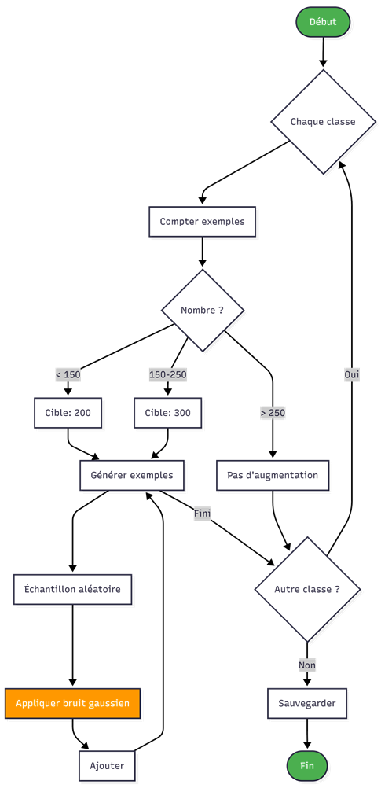
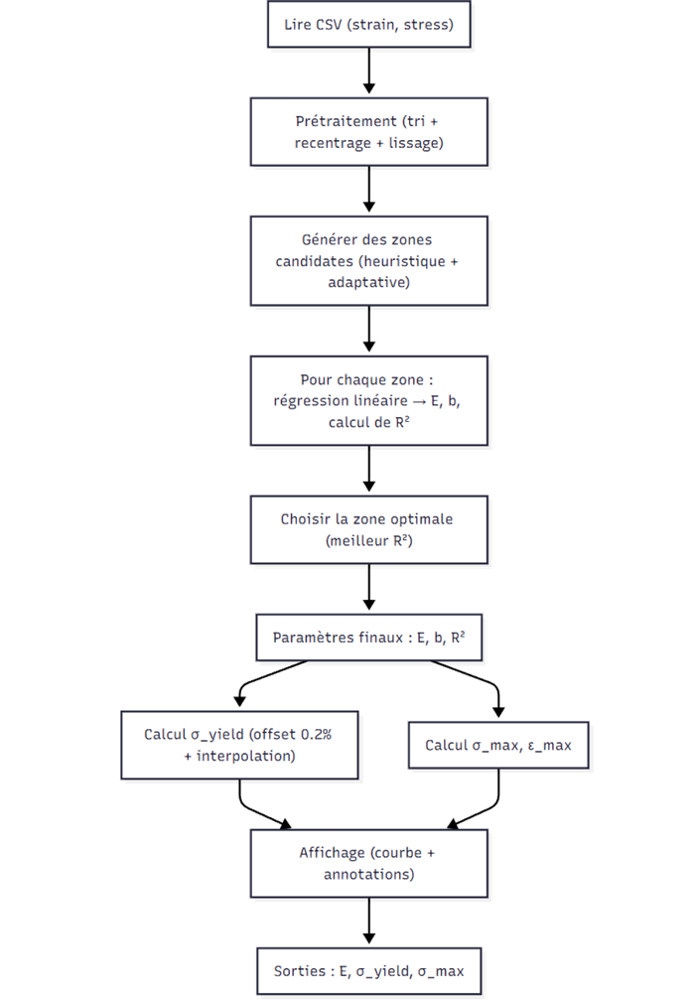
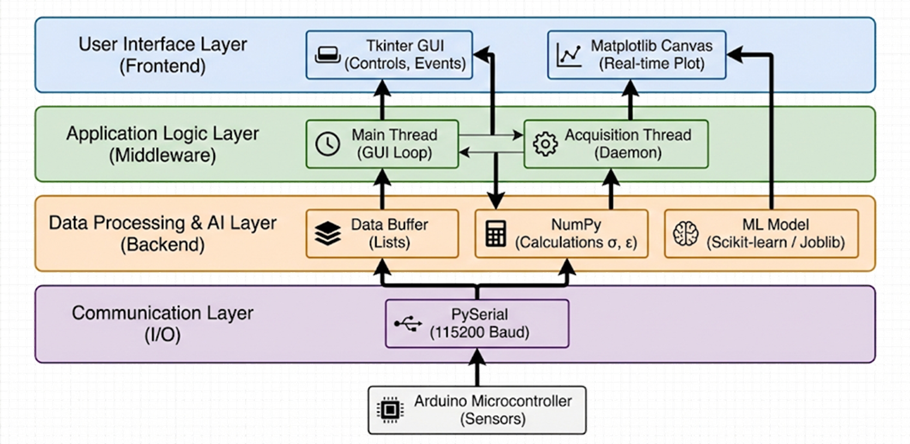

# Machine d'Essai Uniaxiale Intelligente

> Système automatisé de test de compression avec identification de matériaux par Intelligence Artificielle


---

## Description

Ce projet implémente une **interface graphique complète** pour une machine d'essai de compression uniaxiale capable de :

- Appliquer un effort axial de compression jusqu'à **20 kN**
- Mesurer les déplacements avec une résolution de **0.2 mm**
- Générer automatiquement la courbe **contrainte-déformation**
- **Classifier le matériau testé** grâce au Machine Learning

L'application acquiert les données en temps réel via une connexion série (Arduino), calcule les propriétés mécaniques et identifie automatiquement le type de matériau parmi **11 familles** différentes.

---

## Contexte et Problématique

Les propriétés mécaniques des matériaux sont essentielles en génie mécanique et en sciences des matériaux. Les machines d'essais conventionnelles présentent plusieurs limitations :

| Problème | Impact |
|----------|--------|
| Coût élevé | Accès limité pour projets pédagogiques et recherche à budget limité |
| Gabarit important | Difficulté d'intégration dans les laboratoires |
| Peu automatisées | Traitement manuel et chronophage des résultats |
| Faible exploitation des données | Peu de capitalisation et d'apprentissage |

**Solution proposée** : Une machine compacte (60 x 60 x 80 cm), accessible et intelligente, intégrant l'IA pour l'exploitation automatique des essais mécaniques.

---

## Architecture Logicielle

L'architecture est structurée en 4 couches distinctes pour assurer modularité et maintenabilité.



### Structure du Projet

```
interface_robotique/
├── main_gui.py                 # Interface graphique principale
├── rf_material_classifier.pkl  # Modèle Random Forest pré-entraîné
├── label_encoder.pkl           # Encodeur des classes de matériaux
├── scaler.pkl                  # Normaliseur (pour KNN si utilisé)
├── knn_model_metadata.json     # Métadonnées du modèle
├── docs/
│   └── images/                 # Images documentation
├── .gitignore
├── LICENSE
└── README.md
```

> Le schéma ci-dessus illustre la séparation entre la couche Interface, la Logique Applicative, le Traitement des Données et la Communication Série.

```
┌───────────────────────────────────────────────────────────────────┐
│  User Interface Layer (Frontend)                                  │
│  ┌─────────────────────────┐      ┌───────────────────────────┐   │
│  │      Tkinter GUI        │◄────►│     Matplotlib Canvas     │   │
│  │   (Controls, Events)    │      │     (Real-time Plot)      │   │
│  └─────────────────────────┘      └───────────────────────────┘   │
└──────────────▲──────────────────────────────────▲─────────────────┘
               │                                  │
┌──────────────▼──────────────────────────────────▼─────────────────┐
│  Application Logic Layer (Middleware)                             │
│  ┌─────────────────────────┐      ┌───────────────────────────┐   │
│  │      Main Thread        │◄────►│     Acquisition Thread    │   │
│  │      (GUI Loop)         │      │          (Daemon)         │   │
│  └─────────────────────────┘      └───────────────────────────┘   │
└──────────────▲──────────────────────────────────▲─────────────────┘
               │                                  │
┌──────────────▼──────────────────────────────────▼─────────────────┐
│  Data Processing & AI Layer (Backend)                             │
│  ┌──────────────────┐  ┌──────────────────┐  ┌────────────────┐   │
│  │   Data Buffer    │  │      NumPy       │  │    ML Model    │   │
│  │     (Lists)      │  │ (Calculations)   │  │ (Scikit-learn) │   │
│  └──────────────────┘  └──────────────────┘  └────────────────┘   │
└────────────────────────────────▲──────────────────────────────────┘
                                 │
┌────────────────────────────────▼──────────────────────────────────┐
│  Communication Layer (I/O)                                        │
│  ┌────────────────────────────────────────────────────────────┐   │
│  │                 PySerial (115200 Baud)                     │   │
│  └────────────────────────────────────────────────────────────┘   │
└────────────────────────────────▲──────────────────────────────────┘
                                 │
                     ┌───────────▼───────────┐
                     │ Arduino Microcontroller│
                     │       (Sensors)        │
                     └───────────────────────┘
```

---

## Interface Graphique (Tkinter)

L'interface est construite avec **Tkinter** et **Matplotlib** pour offrir une expérience utilisateur moderne avec thème sombre.

### Structure de l'Interface

| Composant | Description |
|-----------|-------------|
| **Header** | Titre, icône et indicateur de statut de connexion |
| **Panneau de contrôle** | Sélection port COM, baudrate, boutons d'action |
| **Graphique** | Courbe σ-ε temps réel avec zoom rectangulaire interactif |
| **Panneau résultats** | Affichage des propriétés mécaniques et prédiction ML |
| **Section export** | Boutons CSV, PNG et sauvegarde base de données |

### Classes Principales

```python
class ModernTheme:
    # Configuration des couleurs et styles de l'interface
    # Palette sombre avec accents colorés

class MaterialAnalyzer:
    # Algorithmes d'extraction des propriétés mécaniques
    # Lissage, régression linéaire, calcul Sy/Su/E

class MLPredictor:
    # Chargement et exécution du modèle de classification
    # Gestion des erreurs et fallback

class ModernAnalysisApp:
    # Application principale Tkinter
    # Gestion acquisition série, affichage, export
```

### Fonctionnalités de l'Interface

L'interface IHM (Interface Homme-Machine) est organisée pour faciliter l'acquisition et l'analyse.



Structure de l'interface :

```
┌─────────────────────────────────────────────────────────────────────────────┐
│                              HEADER                                          │
│  Titre du projet    │    Indicateur de statut de connexion                  │
├─────────────────────────────────────────────────────────────────────────────┤
│                         PANNEAU DE CONTRÔLE                                  │
│  [Port COM ▼]  [Baudrate ▼]  Points: 0  [DÉMARRER] [ANALYSER] [Réinit. vue] │
│                                         [○ Lissé  ○ Original]  [Plein écran]│
├──────────────────────────────────────────┬──────────────────────────────────┤
│                                          │                                   │
│          ZONE DE VISUALISATION           │       PANNEAU RÉSULTATS           │
│                                          │                                   │
│    ┌────────────────────────────────┐    │   MATÉRIAU DÉTECTÉ               │
│    │                                │    │   ┌─────────────────────────┐    │
│    │     Courbe σ-ε temps réel      │    │   │       Acier             │    │
│    │                                │    │   └─────────────────────────┘    │
│    │     ────────────────           │    │                                   │
│    │    /                           │    │   E (Module de Young)            │
│    │   /                            │    │   210,000 MPa                    │
│    │  /                             │    │                                   │
│    │ │                              │    │   Sy (Limite élastique)          │
│    │                                │    │   250 MPa                        │
│    │                                │    │                                   │
│    └────────────────────────────────┘    │   Su (Résistance max)            │
│                                          │   400 MPa                        │
│    Glisser pour zoomer                   │                                   │
│    Double-clic pour réinitialiser        │   R² (Qualité régression)        │
│                                          │   0.9985                         │
│                                          │                                   │
│                                          │   ━━  EXPORTATION  ━━            │
│                                          │   [Exporter CSV] [Exporter PNG]  │
│                                          │   [SAUVEGARDER DANS LA BASE]     │
└──────────────────────────────────────────┴──────────────────────────────────┘
```

- **Connexion série** : Scan automatique des ports COM, baudrate configurable
- **Visualisation temps réel** : Rafraîchissement à 10 Hz, mode lissé/original
- **Zoom interactif** : Sélection rectangulaire, double-clic pour réinitialiser
- **Mode plein écran** : Basculement avec bouton dédié
- **Export** : CSV des données, PNG du graphique, base de données locale

---

## Algorithme d'Extraction des Propriétés Mécaniques

L'extraction des propriétés mécaniques se fait en plusieurs étapes dans la classe `MaterialAnalyzer`.

### 1. Lissage par Moyenne Glissante

Réduction du bruit de mesure par filtrage :

```python
def lissage_moyenne_glissante(y, window_size=7):
    """
    Applique une moyenne glissante centrée.
    
    Pour chaque point i:
        y_lisse[i] = moyenne(y[i-k : i+k+1])
    où k = window_size // 2
    """
    y = np.array(y, dtype=float)
    n = len(y)
    y_lisse = np.zeros_like(y)
    
    demi = window_size // 2
    for i in range(n):
        i_min = max(0, i - demi)
        i_max = min(n, i + demi + 1)
        y_lisse[i] = np.mean(y[i_min:i_max])
    
    return y_lisse
```

### 2. Détermination de la Zone Élastique

Identification automatique de la région linéaire :

```
Si déformation_max >= 0.5%:
    Zone élastique = points où ε <= 0.2%
Sinon:
    Zone élastique = premiers 20% de la courbe
```

### 3. Régression Linéaire (Module de Young)

Calcul du module d'élasticité par moindres carrés :

```python
# Régression linéaire dans la zone élastique
slope, intercept = np.polyfit(strain_elastic, stress_elastic, 1)
E = abs(slope)  # Module de Young en MPa

# Coefficient de détermination
SS_res = sum((stress - stress_predicted)^2)
SS_tot = sum((stress - mean(stress))^2)
R² = 1 - (SS_res / SS_tot)
```

### 4. Limite Élastique (Méthode Offset 0.2%)

Calcul de Sy par intersection avec la droite décalée :

```python
def find_yield_strength(strain, stress, E, offset=0.002):
    """
    Méthode offset 0.2% :
    1. Tracer la droite parallèle: σ_offset = E × (ε - 0.002)
    2. Trouver l'intersection avec la courbe σ-ε
    3. Interpolation linéaire entre les deux points encadrants
    
    Retourne: (Sy, εy) - limite élastique et déformation correspondante
    """
```

### 5. Résistance Maximale

```python
Su = np.max(stress)  # Point maximum de la courbe
```

### Schéma de l'Algorithme Complet

Basé sur l'organigramme de fonctionnement :


Le processus détaillé est le suivant :

```
             ┌───────────────────────┐
             │ Lire CSV (strain, σ)  │
             └──────────┬────────────┘
                        │
                        ▼
       ┌───────────────────────────────────┐
       │ Précodage (tri + recentrage       │
       │ + lissage)                        │
       └────────────────┬──────────────────┘
                        │
                        ▼
       ┌───────────────────────────────────┐
       │ Générer des zones candidates      │
       │ (heuristique + adaptative)        │
       └────────────────┬──────────────────┘
                        │
                        ▼
       ┌───────────────────────────────────┐
       │ Pour chaque zone :                │
       │ Régression linéaire → E, b, R²    │
       └────────────────┬──────────────────┘
                        │
                        ▼
       ┌───────────────────────────────────┐
       │ Choisir la zone optimale          │
       │ (meilleur R²)                     │
       └────────────────┬──────────────────┘
                        │
                        ▼
          ┌─────────────────────────┐
          │ Paramètres finaux :     │
          │ E, b, R²                │
          └────┬──────────────┬─────┘
               │              │
      ┌────────▼───────┐  ┌───▼────────────┐
      │ Calcul Sy      │  │ Calcul σ_max,  │
      │ (offset 0.2%)  │  │ ε_max          │
      └────────┬───────┘  └───┬────────────┘
               │              │
               ▼              ▼
          ┌─────────────────────────┐
          │ Affichage (courbe +     │
          │ annotations)            │
          └────────────┬────────────┘
                       │
                       ▼
           Sorties : E, Sy, Su
```

---

## Algorithmes de Classification

Deux algorithmes de Machine Learning sont implémentés pour classifier les matériaux à partir des propriétés mécaniques extraites.

### Classes de Matériaux (11)

| Métaux ferreux | Alliages non-ferreux | Bronzes |
|----------------|---------------------|---------|
| Acier | Alliage d'aluminium | Bronze au manganèse |
| Fonte grise | Alliage de cuivre | Bronze d'aluminium |
| Fonte malléable | Alliages de magnésium | Bronze à l'étain |
| Fonte nodulaire | Laiton | |

### Features d'Entrée

Le vecteur de features pour la classification :

```python
X = [Su, Sy, E]  # 3 features en MPa
```

Ces trois propriétés mécaniques sont suffisantes pour discriminer les 11 classes de matériaux.

---

### Random Forest Classifier (Modèle en Production)

L'algorithme **Random Forest** est utilisé pour la classification. Il s'agit d'un ensemble de 100 arbres de décision entraînés sur des données augmentées.

**Caractéristiques** :
- Entrée : vecteur `[Su, Sy, E]` en MPa
- Sortie : classe de matériau (11 classes)
- Précision : **78.72%** sur données de test
- Fichier : `rf_material_classifier.pkl`

**Avantages** :
- Pas besoin de normalisation des features
- Robuste au bruit et aux outliers
- Temps de prédiction rapide (~ms)

### Entraînement du Modèle

Le modèle a été entraîné avec data augmentation pour équilibrer le dataset :

| Données | Nombre |
|---------|--------|
| Originales | 1,152 échantillons |
| Augmentées | 8,954 échantillons |
| **Total entraînement** | **10,106 échantillons** |
| Test (originales uniquement) | 289 échantillons |



---

## Installation

### Prérequis
- Python 3.8+
- Arduino avec capteurs de force/déplacement

### Dépendances

```bash
pip install numpy pandas matplotlib pyserial joblib scikit-learn seaborn openpyxl
```

### Lancement

```bash
python main_gui.py
```

---

## Utilisation

### 1. Connexion
1. Brancher l'Arduino via USB
2. Sélectionner le port COM dans l'interface
3. Configurer le baudrate (défaut: 115200)

### 2. Acquisition
1. Cliquer sur **DÉMARRER**
2. La courbe s'affiche en temps réel
3. L'acquisition s'arrête automatiquement à la fin du test

### 3. Analyse
- Les propriétés mécaniques (E, Sy, Su) sont calculées automatiquement
- Le matériau est identifié par le modèle Random Forest
- Basculer entre courbe lissée et originale avec les boutons radio

### 4. Export
- **CSV** : Données brutes ou lissées
- **PNG** : Capture du graphique
- **Base de données** : Ajout à l'historique local

### Format des Données Arduino

```
déformation,contrainte
0.0001,10.5
0.0002,21.3
...
# FIN DU TEST
```

Le signal `# FIN DU TEST` déclenche automatiquement l'analyse.

---

## Architecture du Système de Contrôle

### Schéma de Communication

```
┌─────────────────┐      Série USB      ┌─────────────────┐
│                 │    (115200 baud)    │                 │
│   Interface     │◄──────────────────►│    Arduino      │
│   Python/       │                     │   Contrôleur    │
│   Tkinter       │                     │                 │
│                 │                     │                 │
└─────────────────┘                     └────────┬────────┘
                                                 │
                           ┌─────────────────────┼─────────────────────┐
                           │                     │                     │
                           ▼                     ▼                     ▼
                  ┌─────────────────┐   ┌─────────────────┐   ┌─────────────────┐
                  │  Moteur pas-à-  │   │  Capteur force  │   │    Driver       │
                  │  pas            │   │  + HX711        │   │    moteur       │
                  │  1600 pas/tour  │   │                 │   │                 │
                  └─────────────────┘   └─────────────────┘   └─────────────────┘
```

### Processus de Filtrage des Mesures de Force

Les données brutes du capteur passent par un double filtrage :

```
Données brutes ──► Filtre médian ──► Moyenne mobile ──► Valeur stable
                   (7 échantillons)   (fenêtre de 10)
```

**Filtre médian** : Tri de 7 échantillons, sélection de la valeur centrale (4ème)  
**Moyenne mobile** : Buffer circulaire de 10 valeurs, calcul de la moyenne

### Commandes Série

| Commande | Action |
|----------|--------|
| `1` | Rotation +5 deg (compression) |
| `2` | Rotation -5 deg (décompression) |
| `t` | Tare du capteur de force |

---

## Spécifications Techniques

| Paramètre | Valeur |
|-----------|--------|
| Effort maximal | 20 kN |
| Résolution déplacement | 0.2 mm |
| Gabarit machine | 60 x 60 x 80 cm |
| Communication | Série USB (115200 baud) |
| Précision classification | 78.72% |

---


<p align="center">
  <i>Projet développé dans le cadre d'un projet Robotique de Machine d'essai intelligente</i>
</p>
